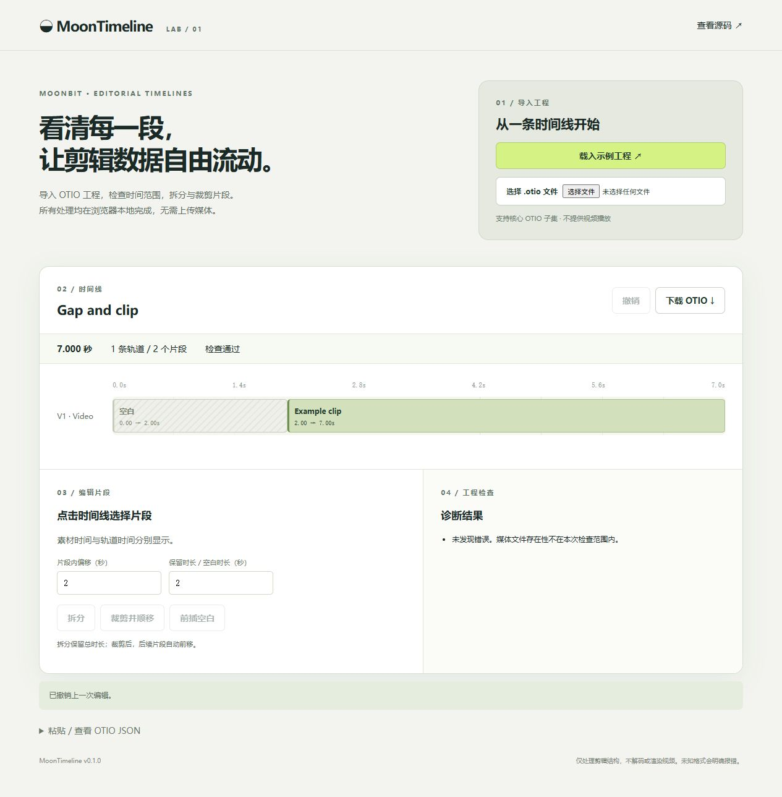

# 浏览器演示（第 12 步）

运行 `node tools/build-js.mjs` 后运行 `node tools/serve.mjs`，访问 http://127.0.0.1:4173/demo/index.html 。
载入示例或本地 OTIO，点击片段，输入片段内偏移/时长（秒），选择拆分、顺移裁剪或前插空白。
支持最近 30 次撤销、下载 OTIO、粘贴 JSON、自动结构化诊断。
编辑与计算调用 MoonBit 编译后的同一核心，JavaScript 只负责 DOM、文件选择和下载。
数据留在本地浏览器，媒体 URL 不会自动访问。不提供视频播放、波形、转场或变速。

已人工浏览器验证：示例导入 → 拆分（2 个对象变 3 个，总长仍 7 秒）→ 下载 → 官方 OTIO 读取 → 撤销。

